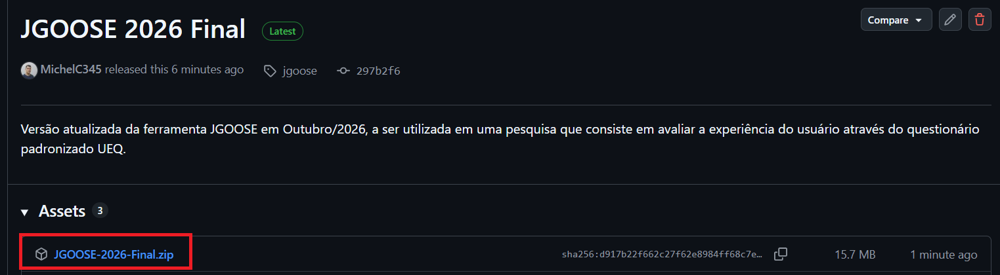
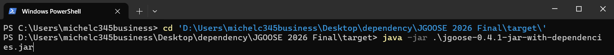
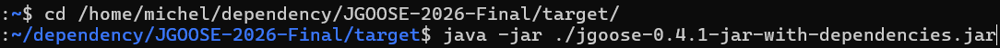

# Documento de Instruções - JGOOSE

| **Autor do Documento** | Michel Caesar |
| --- | --- |
| **Última Alteração** | 26/10/2026 (alterações após a etapa piloto) |

## Como instalar e executar a JGOOSE na sua máquina?

### Como instalar o JDK?

Para executar a JGOOSE, é necessário ter o JDK (Java SE Development Kit) versão 9 ou superior instalado na máquina.

**LINK OFICIAL PARA INSTALAÇÃO**: [https://www.oracle.com/br/java/technologies/downloads/](https://www.oracle.com/br/java/technologies/downloads/)

* Para **Windows**: Recomenda-se as extensões ".exe" e ".msi", devido à maior facilidade de executar imediatamente aplicações que utilizam Java.
* Para **macOS**: Recomenda-se a extensão .dmg (Disk Image), pois oferece um assistente de instalação nativo e simplificado, semelhante ao Windows.
* Para **Linux**:
    * Se você utiliza distribuições baseadas em Debian/Ubuntu (como Linux Mint, Pop!_OS), recomenda-se a extensão .deb, que facilita a instalação pelo gerenciador de pacotes da interface gráfica.
    * Se você utiliza distribuições baseadas em Red Hat/Fedora (como CentOS, Rocky Linux), utilize a extensão .rpm.
    * Para outras distribuições ou instalações manuais, utiliza-se o arquivo compactado .tar.gz.

### **Como fazer download da JGOOSE?**

Instale a versão mais recente da JGOOSE.

**LINK DISPONIBILIZADO PARA INSTALAÇÃO**: [https://github.com/michelc345business/jgoose-docs/releases/](https://github.com/michelc345business/jgoose-docs/releases/)

Extraia o arquivo zipado e siga os passos para executar a JGOOSE como mostra a subseção seguinte.

* **OBSERVAÇÃO IMPORTANTE**: Pode ser necessário colocar a pasta da JGOOSE dentro de um diretório que não tenha espaços e acentos para que a ferramenta funcione da forma correta. Tomando como exemplo o Windows:

    * **Evite colocar** a pasta 'JGOOSE-2026-Final' em diretórios que tenham acentos e/ou caracteres especiais, como por exemplo: "C:\Users\seu-usuario\Área de Trabalho\JGOOSE-2026-Final".
    * Prefira uma pasta que não tenha acentos ou outros caracteres especiais no caminho. Exemplo: "C:\JGOOSE-2026-Final". 

### **Como executar a JGOOSE?**

* Para **Windows**: Dentro da pasta '/target' localizada dentro da pasta da JGOOSE, execute o arquivo “jgoose-VERSAO-jar-with-dependencies.jar” como mostra a imagem abaixo.

* De forma alternativa, você pode executar a JGOOSE pelo Terminal ou PowerShell, através dos comandos "cd '\caminho\para\JGOOSE-2026-Final\target'" e "java -jar .\jgoose-0.4.1-jar-with-dependencies.jar". Considere a imagem abaixo como exemplo.

* Para **Linux/macOS**: Execute a JGOOSE pelo terminal, através dos comandos "cd '/caminho/para/JGOOSE-2026-Final/target'" e "java -jar ./jgoose-0.4.1-jar-with-dependencies.jar". Considere a imagem abaixo como exemplo.

## Manual de Uso - JGOOSE

Este manual contém, de forma sucinta, uma breve descrição de como utilizar cada funcionalidade da ferramenta JGOOSE, contemplando apenas o escopo de funcionalidades abordadas na seção de [Exercícios para Utilização da JGOOSE](#exercicios). Dúvidas adicionais poderão ser sanadas com o **avaliador** responsável por conduzir este estudo, através do e-mail **michel.oliveira2@unioeste.br** e demais contatos disponibilizados.

### Como salvar arquivos

Você pode salvar arquivos, seja esse arquivo um diagrama iStar ou um Caso de Uso diagramático.

Clique no ícone de disco (ou aperte simultaneamente Ctrl e S), escolha o nome do arquivo e o salve com a extensão indica (geralmente “.mxe”). Após isso, sempre que você apertar simultaneamente Ctrl e S ou clicar no ícone de disco, suas alterações serão salvas no respectivo arquivo. Veja os 2 vídeos abaixo como exemplo.

<video width="100%" controls>
  <source src="../assets/videos/salvar-istar-edit.mp4" type="video/mp4">
</video>

<video width="100%" controls>
  <source src="../assets/videos/salvar-casodeuso-diagramatico.mp4" type="video/mp4">
</video>

### Como gerar um diagrama iStar

Estando na tela inicial, acesse a opção “i* 2.0 Editor”.

#### Incluir e renomear um Ator (Actor), um Agente (Agent) e/ou uma função (Role)

Para incluir um Ator (Actor), um Agente (Agent) e/ou uma função (Role), clique com o mouse no respectivo ícone e arraste com o mouse até o espaço à direita. Para renomear, clique 2 vezes em cima do respectivo ator, digite o nome e aperte Enter.

<video width="100%" controls>
  <source src="../assets/videos/Recording_2026-09-28_150814.mp4" type="video/mp4">
  Seu navegador não suporta vídeo HTML5.
</video>

#### Adicionar um Link de relacionamento do tipo is-a e participantes-in entre atores (Actor, Agent, Role) ou uma relação de dependência entre um ator e um elemento intencional (Goal, Quality, Resource, Task)

Clique com o mouse no respectivo ícone do link. Em seguida, clique (bem ao centro do texto) no respectivo ator ou elemento de origem e arraste-o para o respectivo ator ou elemento de destino.

<video width="100%" controls>
  <source src="../assets/videos/links-jgoose.mp4" type="video/mp4">
</video>

**O mesmo procedimento vale para outros tipos de ligações**, como por exemplo quando se deseja estabelecer uma relação do tipo 'Qualification' entre uma Quality e uma Task. Todavia, **é necessário atentar-se à ordem**: é possível estabelecer uma relação do tipo 'Qualification' entre uma Quality e uma Task, mas não o contrário. Quando uma relação inválida é estabelecida, uma mensagem de erro é exibida. É necessário respeitar a ordem correta. Considere os dois vídeos abaixo como exemplo.

<video width="100%" controls>
  <source src="../assets/videos/exemplo-link-invalido.mp4" type="video/mp4">
</video>

<video width="100%" controls>
  <source src="../assets/videos/exemplo-link-invalido-2.mp4" type="video/mp4">
</video>

Para ajustes na organização, **você pode ajustar a curvatura dos links de relação**. Considere o vídeo abaixo como anexo, onde é ajustada a curvatura de um link entre uma Task e uma Quality.

<video width="100%" controls>
  <source src="../assets/videos/ajustar-curva-link.mp4" type="video/mp4">
</video>

#### Quebrar a linha dentro de um Ator ou Elemento de Dependência

No local onde deseja inserir a quebra de linha, aperte simultaneamente as teclas Shift e Enter.

<video width="100%" controls>
  <source src="../assets/videos/quebra-linha-jgoose-edit.mp4" type="video/mp4">
</video>

#### Arrastar mais de 2 elementos na tela ao mesmo tempo

Segure o mouse principal e selecione uma área retangular em volta dos elementos que deseja mover. Em seguida arraste o mouse para mover os itens selecionados.

<video width="100%" controls>
  <source src="../assets/videos/Recording_2026-09-28_140833.mp4" type="video/mp4">
</video>

#### Duplicar um elemento

Clique sobre o elemento, aperte simultaneamente Ctrl e C, depois Ctrl e V para duplicar o elemento. No exemplo mencionado foi duplicada uma Task, mas isso pode valer para quaisquer outros elementos, como Actor, Quality, Resource e Goal.

<video width="100%" controls>
  <source src="../assets/videos/duplicar-elemento-jgoose.mp4" type="video/mp4">
</video>

#### Incluir um boundary no ator Sistema {#incluir-boundary-istar}

Clique com o botão direito sobre o ator, depois em "Add Boundary". Após isso você pode arrastar quaisquer elementos do tipo Task, Resource e Quality para dentro desse 'boundary', para indicar que aquilo faz parte do respectivo ator. Um indicador azul deve aparecer na hora que arrastar os elementos indicando para por dentro do boundary. Considere o video abaixo como exemplo.

<video width="100%" controls>
  <source src="../assets/videos/incluir-boundary-sistema-istar.mp4" type="video/mp4">
</video>

#### Mapear um diagrama iStar para casos de uso textuais a partir de um ator específico {#mapear-istar-casosdeuso-textuais}

Tendo um diagrama iStar aberto, clique em "File -> Generate Use Cases". Selecione a partir de qual ator deseja mapear. No caso desse exemplo, considera-se o ator "Sistema". Clique em "Yes" para visualizar os casos de uso textuais mapeados.

<video width="100%" controls>
  <source src="../assets/videos/mapear-istar-casodeuso-textual.mp4" type="video/mp4">
</video>

### Como manipular casos de uso

#### Exportar a descrição de um caso de uso textual {#exportar-a-descrição-de-um-caso-de-uso-textual}

Estando na tela dos casos de uso textuais, clique no respectivo caso de uso, depois em "Export this Specification", e em seguida salve o arquivo ".doc" com o nome de sua preferência.

<video width="100%" controls>
  <source src="../assets/videos/exportar-casodeuso-textual.mp4" type="video/mp4">
</video>

#### Exportar a descrição de todos os casos de uso textuais {#exportar-todos-casosdeuso-textuais}

Estando na tela dos casos de uso textuais, clique em "Export all Use Cases descriptions", e em seguida salve o arquivo ".doc" com o nome de sua preferência.

<video width="100%" controls>
  <source src="../assets/videos/exportar-todos-casosuso-textuais.mp4" type="video/mp4">
</video>

#### Revisar um caso de uso textual {#revisar-casodeuso-manual}

Abra o arquivo .doc gerado e revise. Considere o vídeo abaixo como exemplo, onde é mostrado como seria uma primeira impressão sobre a descrição textual do caso de uso "Consultar produto".

<video width="100%" controls>
  <source src="../assets/videos/revisar-casodeuso-manual.mp4" type="video/mp4">
</video>

#### Visualizar casos de uso diagramáticos {#visualizar-casosdeuso-diagramaticos}

Estando na tela onde são dispostos os casos de uso, clique em "Diagram". O diagrama poderá ser visualizado. Lembre-se que você também [pode salvar esse diagrama em um arquivo ".mxe"](#como-salvar-arquivos).

* **OBSERVAÇÃO IMPORTANTE**: Caso você esteja executando a JGOOSE em um sistema operacional baseado em Linux, é provável que o botão "Diagram" esteja com texto branco e fundo em branco, mas ainda deve ser possível clicar.

<video width="100%" controls>
  <source src="../assets/videos/mapear-casodeuso-diagrama.mp4" type="video/mp4">
</video>

#### Adicionar um caso de uso diagramático {#adicionar-casodeuso-diagramatico}

Estando na tela onde os casos de uso diagramáticos estão dispostos, selecione o elemento "Use Case" e o arraste para o diagrama. Nomeie o caso de uso para o nome de sua preferência e estabeleça as relações necessárias. Considere o video abaixo como exemplo. Neste exemplo, considera-se que o sistema possui uma funcionalidade que é "imprimir dados de uma venda", e apenas o ator Funcionário pode imprimir dados de uma venda.

<video width="100%" controls>
  <source src="../assets/videos/adicionar-casodeuso-diagramatico.mp4" type="video/mp4">
</video>

#### Mapear casos de uso diagramáticos para diagrama iStar {#mapear-casodeuso-diagramatico-istar}

Execute a opção "File -> Generate iStar". Considere o video abaixo como exemplo. Observa-se que é necessário incluir um "system boundary".

<video width="100%" controls>
  <source src="../assets/videos/mapear-casodeuso-diagramatico-istar.mp4" type="video/mp4">
</video>

## Exercícios para Utilização da JGOOSE {#exercicios}

Nesta seção descreve-se a sequência de passos a serem seguidos. O objetivo é fazer com que o participante da pesquisa utilize a JGOOSE no que concerne ao seguinte escopo de funcionalidades:

- Geração de diagrama iStar.
- Mapeamento iStar -> casos de uso textuais.
- Exportação de casos de uso textuais.
- Visualização de casos de uso diagramáticos.
- Adição de um caso de uso diagramático.
- Mapeamento casos de uso diagramáticos -> iStar.

Com o objetivo de fornecer ao participante uma transparência sobre qual é a estimativa de tempo para conclusão dos exercícios, **para cada exercício definiu-se um tempo estimado para o participante concluir o que é exigido**. O tempo estimado foi calculado baseando-se em testes conduzidos com participantes voluntários em etapas que antecederam a aplicação deste instrumento de avaliação.

Dúvidas adicionais que surgirem durante a resolução dos exercícios poderão ser sanadas com o **avaliador** responsável por conduzir este estudo, através do e-mail **michel.oliveira2@unioeste.br** e demais contatos disponibilizados.

**EXERCÍCIO 01**: Utilizando o Editor i* 2.0 presente na JGOOSE, utilize-o para [desenvolver o diagrama iStar](#como-gerar-um-diagrama-istar) conforme ilustra a imagem abaixo. (TEMPO ESTIMADO: aproximadamente 20 minutos)

> Diagrama iStar a ser gerado

**EXERCÍCIO 02**: [Salve](#como-salvar-arquivos) o diagrama iStar gerado no Exercício 01. (TEMPO ESTIMADO: < 1 minuto)

**EXERCÍCIO 03**: Certifique-se de que todos os elementos do tipo Task, Resource e Goal estejam [inclusos dentro da boundary](#incluir-boundary-istar) do ator "Sistema" em conformidade com a figura do Exercício 01. (TEMPO ESTIMADO: < 1 minuto)

**EXERCÍCIO 04**: Utilizando a JGOOSE, [mapeie](#mapear-istar-casosdeuso-textuais) o diagrama iStar que você desenhou para Casos de Uso **textuais**. Considere o ator “Sistema”. Clique em "Yes" para abrir a tela e visualizar os Casos de Uso textuais mapeados. (TEMPO ESTIMADO: 2 minutos)

**EXERCÍCIO 05**: [Exporte](#exportar-a-descrição-de-um-caso-de-uso-textual) a descrição do Caso de Uso textual “Efetuar Venda”. (TEMPO ESTIMADO: < 1 minuto)

**EXERCÍCIO 06**: [Exporte](#exportar-todos-casosdeuso-textuais) a descrição de todos os Casos de Uso gerados. (TEMPO ESTIMADO: < 1 minuto)

**EXERCÍCIO 07**: Abra o arquivo .doc gerado no exercício 05 e [revise o Caso de Uso textual](#revisar-casodeuso-manual) "Efetuar Venda". (TEMPO ESTIMADO: 3 minutos).

**EXERCÍCIO 08**: [Visualize](#visualizar-casosdeuso-diagramaticos) os casos de uso diagramáticos. (TEMPO ESTIMADO: < 1 minuto)

**EXERCÍCIO 09**: Considere que o sistema tomado como exemplo agora tem um novo caso de uso no qual a impressão dos dados de uma venda pode ser realizada independentemente da finalização de uma venda — por exemplo, para consultar e reimprimir os dados de uma venda antiga. [Adicione um novo caso de uso diagramático](#adicionar-casodeuso-diagramatico) "Imprimir dados de uma venda" como um caso de uso independente. Considere que tanto o ator Funcionário quanto o ator Gerente poderiam utilizar a funcionalidade de imprimir dados de uma venda (TEMPO ESTIMADO: < 1 minuto).

**EXERCÍCIO 10**: [Salve](#como-salvar-arquivos) os casos de uso diagramáticos.

**EXERCÍCIO 11**: Após realizar a adição do caso de uso conforme solicitado no exercício 09, [mapeie os casos de uso diagramáticos para o diagrama iStar](#mapear-casodeuso-diagramatico-istar) (TEMPO ESTIMADO: < 1 minuto).

**EXERCÍCIO 12**: [Salve](#como-salvar-arquivos) o diagrama iStar gerado.

## Questionário UEQ

Baseando-se no uso que você fez na JGOOSE, [responda a esse questionário no Google Forms](https://forms.gle/ww6ZWWwDq4SCMQV5A) (TEMPO ESTIMADO PARA RESPOSTA: entre 3 a 5 minutos).

Esta é a versão do UEQ (*User Experience Questionnaire* -- Questionário da Experiência do Usuário) traduzida para a língua portuguesa (de Portugal). Consiste em 26 itens com uma escala de avaliação do diferencial semântico de sete pontos. Esses itens abrangem seis escalas de experiência do usuário: 

* atratividade (impressão geral do produto), 
* eficiência (impressão do usuário no alcance de metas), 
* perspicuidade (impressão quanto à facilidade de compreensão), 
* confiabilidade (sentimentos do usuário quanto segurança e controle da interação com a interface), 
* estímulo (impressão de que é divertido e interessante utilizar o sistema) e 
* novidade (impressão de que o design do produto é inovador, criativo). 

Caso tenha curiosidade em saber mais sobre esse questionário, o site oficial do UEQ está disponível [neste link](https://www.ueq-online.org/).

Dúvidas adicionais poderão ser sanadas com o **avaliador** responsável por conduzir este estudo, através do e-mail **michel.oliveira2@unioeste.br** e demais contatos disponibilizados.