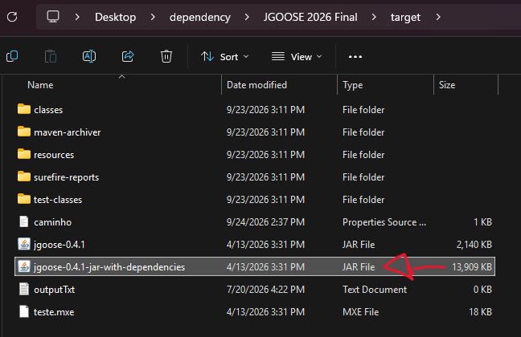
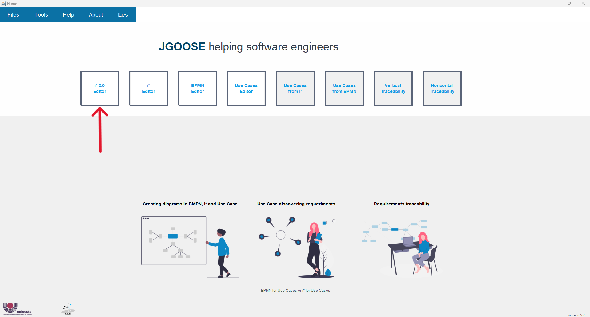
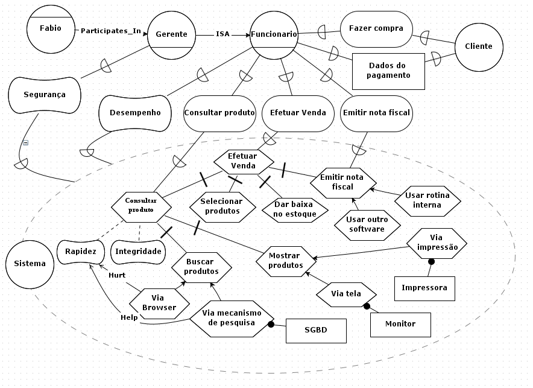

# Documento de Instruções - JGOOSE

| **Autor do Documento** | Michel Caesar |
| --- | --- |
| **Última Alteração** | 02/10/2026 (pré-teste) |

## Manual de Uso - JGOOSE

Este manual contém, de forma sucinta, uma breve descrição de como utilizar cada funcionalidade da ferramenta JGOOSE, contemplando apenas o escopo de funcionalidades abordadas na seção de [Exercícios para Utilização da JGOOSE](#exercicios). Dúvidas adicionais poderão ser sanadas com o avaliador responsável por conduzir este estudo, e que estará presente na sala no momento da aplicação deste instrumento de avaliação.

### **Como executar a JGOOSE? (pule este passo caso já esteja executando a JGOOSE na máquina)**

Requisito básico: JRE (Java Runtime Environment) versão 9 ou superior instalado na máquina.

Execute o arquivo “jgoose-VERSAO-jar-with-dependencies.jar” conforme consta na imagem abaixo.

### Como salvar arquivos

Você pode salvar arquivos, seja esse arquivo um diagrama iStar ou um Caso de Uso diagramático.

Clique no ícone de disco (ou aperte simultaneamente Ctrl e S), escolha o nome do arquivo e o salve com a extensão indica (geralmente “.mxe”). Após isso, sempre que você apertar simultaneamente Ctrl e S ou clicar no ícone de disco, suas alterações serão salvas no respectivo arquivo. Veja os 2 vídeos abaixo como exemplo.

<video width="100%" controls>
  <source src="../assets/videos/salvar-istar-edit.mp4" type="video/mp4">
</video>

<video width="100%" controls>
  <source src="../assets/videos/salvar-casodeuso-diagramatico.mp4" type="video/mp4">
</video>

### Como gerar um diagrama iStar

Estando na tela inicial, acesse a opção “i* 2.0 Editor”.

#### Incluir e renomear um Ator (Actor), um Agente (Agent) e/ou uma função (Role)

Para incluir um Ator (Actor), um Agente (Agent) e/ou uma função (Role), clique com o mouse no respectivo ícone e arraste com o mouse até o espaço à direita. Para renomear, clique 2 vezes em cima do respectivo ator, digite o nome e aperte Enter.

<video width="100%" controls>
  <source src="../assets/videos/Recording_2026-09-28_150814.mp4" type="video/mp4">
  Seu navegador não suporta vídeo HTML5.
</video>

#### Adicionar um Link de relação ou contribuição

Clique com o mouse no respectivo ícone do link, arraste-o para o respectivo ator ou elemento de origem. Em seguida, clique no respectivo ator ou elemento de origem e arraste-o para o respectivo ator ou elemento de destino.  

<video width="100%" controls>
  <source src="../assets/videos/links-jgoose.mp4" type="video/mp4">
</video>

#### Quebrar a linha dentro de um Ator ou Elemento de Dependência

No local onde deseja inserir a quebra de linha, aperte simultaneamente as teclas Shift e Enter.

<video width="100%" controls>
  <source src="../assets/videos/quebra-linha-jgoose-edit.mp4" type="video/mp4">
</video>

#### Arrastar mais de 2 elementos na tela ao mesmo tempo

Segure o mouse principal e selecione uma área retangular em volta dos elementos que deseja mover. Em seguida arraste o mouse para mover os itens selecionados.

<video width="100%" controls>
  <source src="../assets/videos/Recording_2026-09-28_140833.mp4" type="video/mp4">
</video>

#### Duplicar um elemento

Clique sobre o elemento, aperte simultaneamente Ctrl e C, depois Ctrl e V para duplicar o elemento.

<video width="100%" controls>
  <source src="../assets/videos/duplicar-elemento-jgoose.mp4" type="video/mp4">
</video>

#### Mapear um diagrama iStar para casos de uso textuais a partir de um ator específico

Tendo um diagrama iStar aberto, clique em "File -> Generate Use Cases". Selecione a partir de qual ator deseja mapear. No caso desse exemplo, considerou-se o ator "Sistema". Clique em "Yes" para visualizar os casos de uso textuais mapeados.

<video width="100%" controls>
  <source src="../assets/videos/mapear-istar-casodeuso.mp4" type="video/mp4">
</video>

### Como manipular casos de uso

#### Exportar a descrição de um caso de uso textual

Estando na tela dos casos de uso textuais, clique no respectivo caso de uso, depois em "Export", e em seguida salve o arquivo ".doc" com o nome de sua preferência.

<video width="100%" controls>
  <source src="../assets/videos/exportar-casodeuso-textual.mp4" type="video/mp4">
</video>

#### Revisar um caso de uso textual com auxílio de uma LLM {#revisar-casodeuso-llm}

Para facilitar a compreensão sobre um caso de uso textual, você pode ter o auxílio de uma LLM da sua escolha. Copie e cole o conteúdo do arquivo .doc e solicite a revisão. Considere o vídeo abaixo como exemplo.

<video width="100%" controls>
  <source src="../assets/videos/revisar-casodeuso-llm.mp4" type="video/mp4">
</video>

#### Mapear casos de uso textuais para casos de uso diagramáticos

Estando na tela onde são dispostos os casos de uso, clique em "Diagram". O diagrama poderá ser visualizado. Lembre-se que você também [pode salvar esse diagrama em um arquivo ".mxe"](#como-salvar-arquivos).

<video width="100%" controls>
  <source src="../assets/videos/mapear-casodeuso-diagrama.mp4" type="video/mp4">
</video>

#### Adicionar um caso de uso diagramático {#adicionar-casodeuso-diagramatico}

Estando na tela onde os casos de uso diagramáticos estão dispostos, selecione o elemento "Use Case" e o arraste para o diagrama. Nomeie o caso de uso para o nome de sua preferência e estabeleça as relações necessárias. Considere o video abaixo como exemplo. Neste exemplo, considera-se que o sistema possui uma funcionalidade que é "imprimir dados de uma venda", e apenas o ator Funcionário pode imprimir dados de uma venda.

<video width="100%" controls>
  <source src="../assets/videos/adicionar-casodeuso-diagramatico.mp4" type="video/mp4">
</video>

#### Mapear casos de uso 

## Exercícios para Utilização da JGOOSE {#exercicios}

Nesta seção descreve-se a sequência de passos a serem seguidos. O objetivo é fazer com que o participante da pesquisa utilize a JGOOSE no que concerne ao seguinte escopo de funcionalidades:

- Geração de diagrama iStar.
- Mapeamento iStar -> casos de uso textuais.
- Exportação de casos de uso textuais.
- Mapeamento casos de uso textuais -> casos de uso diagramáticos.
- Adição de um caso de uso diagramático.
- Mapeamento casos de uso diagramáticos -> iStar.

Com o objetivo de fornecer ao participante uma transparência sobre qual é a estimativa de tempo para conclusão dos exercícios, **para cada exercício definiu-se um tempo estimado para o participante concluir o que é exigido**. O tempo estimado foi calculado baseando-se em testes conduzidos com participantes voluntários em etapas que antecederam a aplicação deste instrumento de avaliação.

Dúvidas adicionais que surgirem durante a resolução dos exercícios poderão ser sanadas com o **avaliador** responsável por conduzir este estudo, e que **estará presente na sala no momento da aplicação deste instrumento de avaliação**.

**EXERCÍCIO 01**: Utilizando o Editor i* 2.0 presente na JGOOSE, utilize-o para desenvolver o diagrama iStar conforme ilustra a imagem abaixo. (TEMPO ESTIMADO: aproximadamente 20 minutos)

> Diagrama iStar a ser gerado

**EXERCÍCIO 02**: Salve o diagrama iStar gerado no Exercício 01. (TEMPO ESTIMADO: < 1 minuto)

**EXERCÍCIO 03**: Utilizando a JGOOSE, mapeie o diagrama iStar que você desenhou para Casos de Uso **textuais**. Considere o ator “Sistema”. Clique em "Yes" para abrir a tela e visualizar os Casos de Uso textuais mapeados. (TEMPO ESTIMADO: < 1 minuto)

**EXERCÍCIO 04**: Exporte a descrição do Caso de Uso textual “Efetuar Venda”. (TEMPO ESTIMADO: < 1 minuto)

**EXERCÍCIO 05**: Exporte a descrição de todos os Casos de Uso gerados. (TEMPO ESTIMADO: < 1 minuto)

**EXERCÍCIO 06**: Abra o arquivo .doc gerado pelo exercício 04 e revise o Caso de Uso textual obtido. Se preferir, [pode enviar o arquivo .doc gerado para uma LLM de sua escolha e solicitar a revisão](#revisar-casodeuso-llm) (TEMPO ESTIMADO: aproximadamente 3 minutos).

**EXERCÍCIO 07**: Mapeie os casos de uso textuais para casos de uso diagramáticos. (TEMPO ESTIMADO: < 1 minuto)

**EXERCÍCIO 08**: Considere que o sistema tomado como exemplo agora tem um novo caso de uso no qual a impressão dos dados de uma venda pode ser realizada independentemente da finalização de uma venda — por exemplo, para consultar e reimprimir os dados de uma venda antiga. [Adicione um novo caso de uso diagramático](#adicionar-casodeuso-diagramatico) "Imprimir dados de uma venda" como um caso de uso independente. Considere que tanto o ator Funcionário quanto o ator Gerente poderiam utilizar a funcionalidade de imprimir dados de uma venda (TEMPO ESTIMADO: < 1 minuto).

**EXERCÍCIO 09**: Após realizar a adição do caso de uso conforme solicitado no exercício 08, mapeie os casos de uso diagramáticos para o diagrama iStar (TEMPO ESTIMADO: < 1 minuto).

## Questionário UEQ

Baseando-se no uso que você fez da JGOOSE, responda a esse questionário no Google Forms.

Esta é uma versão traduzida do UEQ (*User Experience Questionnaire* -- Questionário da Experiência do Usuário). Consiste em 26 escalas com 6 itens cada. A explicação sobre cada escala pode ser lida abaixo. Dúvidas adicionais poderão ser sanadas com o **avaliador** responsável por conduzir este estudo, e que **estará presente na sala no momento da aplicação deste instrumento de avaliação**. (TEMPO ESTIMADO PARA RESPOSTA: aproximadamente 10 minutos).